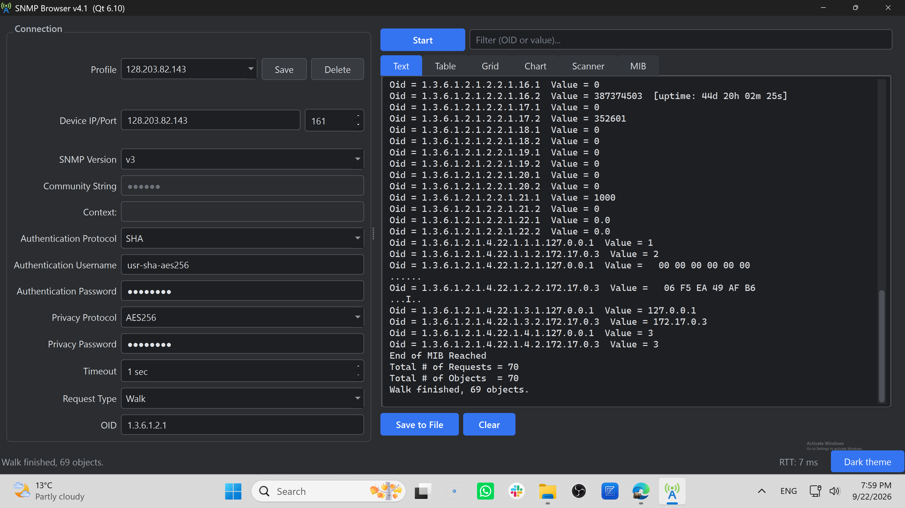

# Native Windows SNMP MIB Browser & OID Scanner

A fast, lightweight, and modern SNMP MIB Browser & OID Scanner built natively for Windows. Designed specifically for system administrators, network engineers, and IT professionals who need an offline-first, privacy-focused network diagnostic tool.

---

## 📸 Application Screenshot

---

## 🎬 Video Demo & Walkthrough

Watch the presentation and demo of SNMP Browser in action:

- **Overview & Introduction:**   
  👉 **[Watch Intro on YouTube (at 12s)](https://www.youtube.com/watch?v=d5HTdIDzBAk&t=12s)**

- **Demo & Walkthrough:**   
  👉 **[Watch Demo on YouTube](https://youtu.be/No2jubzWMcs)**

---

## ⚡ Key Features

- **Ultra-Fast Native Performance:** Built with native C++ for maximum speed, instant launching, and minimal CPU/memory footprint—no heavy Electron or Java runtime required.
- **100% Offline & Private:** Zero telemetry, zero tracking, and no cloud dependencies. Your network diagnostics data stays entirely on your local machine.
- **Full MIB Tree Navigation:** Effortlessly load, parse, and browse complex MIB files with an intuitive hierarchy tree.
- **Complete SNMP Operations:** Full support for SNMP Walk, Get, GetNext, and Set operations across custom OID paths (SNMP v1, v2c, and v3 supported).

---

## 📥 Download & Installation

The official, digitally signed, and certified version is available exclusively on the Microsoft Store:

👉 [Download SNMP Browser from Microsoft Store](https://apps.microsoft.com/detail/9NHBN8PJ63FF?hl=en-us&gl=HR&ocid=pdpshare)

### Why Microsoft Store?
- **Automatic Background Updates:** Always stay up to date with the latest features and security fixes.
- **One-Click Installation:** Verified and scanned by Microsoft for seamless deployment.
- **Zero Admin Hassle:** Easy installation without complex system dependencies.

---

## 💬 Bug Reports & Feature Requests

This repository serves as the official issue tracker and community hub for SNMP Browser.

- Found a bug? Submit a detailed report on the [Issues Page](https://github.com/srdzank/snmp-mib-browser-windows/issues).
- Have an idea? Suggest new features or improvements to help shape future releases.
- Release Notes: Track the latest version changes and improvements in the [Releases Tab](https://github.com/srdzank/snmp-mib-browser-windows/releases).

---

## 🛡️ Security & Integrity

SNMP Browser is packaged using Microsoft Store's official MSIX container system. It operates with strict sandboxing and zero background data collection, ensuring full compliance with strict corporate network security policies.

---

  <i>Developed for IT Professionals seeking reliable, clean, and fast Windows administrative utilities.</i>

